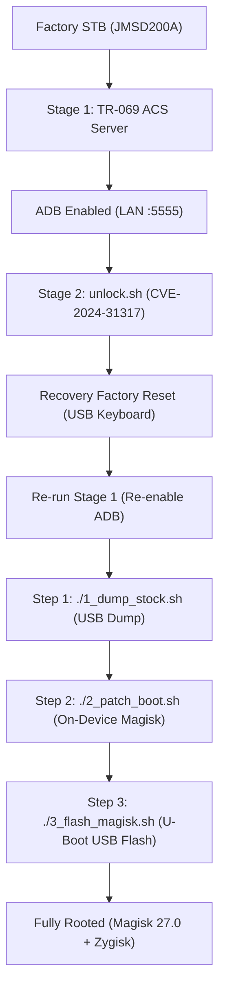

# Jio Set-Top Box (JMSD200A / C200A) Master Cookbook: Re-Do & Restore Guide

> **Hardware Target:** Jio Set-Top Box **JMSD200A** / **JMSC200A**  
> **SoC Platform:** Amlogic S905X4 (Board: `ohm`, 64-bit ARMv8)  
> **Android Version:** Android 11 (Amlogic OEM Build `25.1.9`)  
> **Root Solution:** Magisk v27.0 (Native Pre-init `cache` patch) with Zygisk  
> **Primary Slot:** Slot B (`_b`) | **Fallback Stock Slot:** Slot A (`_a`)  

---

## Table of Contents
1. [Overview & Architectural Breakthroughs](#1-overview--architectural-breakthroughs)
2. [Driver & Host Environment Setup (Windows & Ubuntu)](#2-driver--host-environment-setup-windows--ubuntu)
3. [The Complete Ground-Zero Rooting Workflow](#3-the-complete-ground-zero-rooting-workflow)
   - [Phase 1: Stage 1 — TR-069 ACS ADB Activation](#phase-1-stage-1--tr-069-acs-adb-activation)
   - [Phase 2: Stage 2 — Bootloader Unlock & Factory Reset](#phase-2-stage-2--bootloader-unlock--factory-reset)
   - [Phase 3: Step 1 — Partition Dumping via U-Boot USB](#phase-3-step-1--partition-dumping-via-u-boot-usb)
   - [Phase 4: Step 2 — Native On-Device Magisk Patching](#phase-4-step-2--native-on-device-magisk-patching)
   - [Phase 5: Step 3 — Hardware U-Boot Flashing & Root Verification](#phase-5-step-3--hardware-u-boot-flashing--root-verification)
4. [Master Stock Restoration & Rollback Cookbook](#4-master-stock-restoration--rollback-cookbook)
   - [Method 1: Instant Root Restore (10 Seconds)](#method-1-instant-root-restore-10-seconds)
   - [Method 2: Hardware U-Boot USB Restore (No Root Needed)](#method-2-hardware-u-boot-usb-restore-no-root-needed)
   - [Method 3: Slot A Instant Hardware Rollback](#method-3-slot-a-instant-hardware-rollback)
   - [Method 4: Full Factory eMMC Re-flash](#method-4-full-factory-emmc-re-flash)
   - [Method 5: Bootloader Relock & SELinux Enforcing](#method-5-bootloader-relock--selinux-enforcing)
5. [Critical Pitfalls & Safety Rules](#5-critical-pitfalls--safety-rules)
6. [Automated Script Reference](#6-automated-script-reference)

---

## 1. Overview & Architectural Breakthroughs

On Jio STB firmware `25.1.9`, standard Android modification tools fail for four distinct reasons:

1. **SELinux Hard Enforcing:** Android init (`/system/bin/init`) is compiled with `-DALLOW_PERMISSIVE_SELINUX=0`. Even if U-Boot sets `EnableSelinux=permissive`, init forces `enforcing=1` 2.6 seconds into boot.
2. **SELinux Block Access Denial:** The OEM `sdknativeservice` (used in older PoCs to dump partitions) lacks access to `block_device:dir`, making `dd /dev/block/by-name/boot_b` return `Permission denied`.
3. **Disabled Fastboot Protocol:** The OEM Amlogic U-Boot fastboot implementation rejects external USB protocol flashing (`download` command) with `remote: 'unrecognized command'`.
4. **Fastbootd Gadget Drop:** The userspace recovery kernel (`fastbootd`) fails to initialize the USB gadget driver on the JMSD200A, dropping all USB communication upon entering recovery.

### The Solutions Developed in this Toolkit
- **Direct-to-USB U-Boot Dumper (`1_dump_stock.sh`):** Injects U-Boot commands (`store read` + `fatwrite usb`) via CVE-2024-31317. Partitions are dumped directly from eMMC to a FAT32 USB drive at the bootloader hardware level, completely bypassing Android SELinux.
- **On-Device Magisk Patching (`2_patch_boot.sh`):** Magisk must dynamically identify the hardware pre-init partition. Running `magisk32 --preinit-device` on the STB detects `cache`. Patching on PC causes bootloops; patching on-device produces a 100% stable 64 MB image.
- **Fail-Safe U-Boot Flash Pipeline (`3_flash_magisk.sh`):** Bypasses fastboot by staging `boot_b.img` on FAT32 USB, executing `store write 0x10000000 boot_b 0 0x4000000` inside U-Boot, strictly guarded by `if test ${loaded} = 1`.

---

## 2. Driver & Host Environment Setup (Windows & Ubuntu)

### A. Ubuntu Linux Setup

1. **Install Core Utilities:**
   ```bash
   sudo apt-get update
   sudo apt-get install -y android-tools-adb android-tools-fastboot openjdk-17-jdk unzip curl git libusb-1.0-0
   ```

2. **Configure Udev Rules (Crucial for Non-Root USB Access):**
   Create `/etc/udev/rules.d/51-android.rules`:
   ```bash
   sudo bash -c 'cat << "EOF" > /etc/udev/rules.d/51-android.rules
   # Google ADB / Fastboot
   SUBSYSTEM=="usb", ATTR{idVendor}=="18d1", MODE="0666", GROUP="plugdev"
   # Amlogic USB Burning Mode & Fastboot
   SUBSYSTEM=="usb", ATTR{idVendor}=="1b8e", MODE="0666", GROUP="plugdev"
   SUBSYSTEM=="usb", ATTR{idVendor}=="1b8e", ATTR{idProduct}=="0ce3", MODE="0666", GROUP="plugdev"
   EOF'
   ```
   Reload udev rules and add your user to `plugdev`:
   ```bash
   sudo udevadm control --reload-rules
   sudo udevadm trigger
   sudo usermod -aG plugdev $USER
   ```

3. **Verify ADB:**
   ```bash
   adb version
   # Expected: Android Debug Bridge version 1.0.41+
   ```

---

### B. Windows Host Setup (Windows 10 / 11)

1. **Install Android Platform Tools:**
   - Download official [SDK Platform-Tools for Windows](https://developer.android.com/tools/releases/platform-tools).
   - Extract to `C:\platform-tools` and add `C:\platform-tools` to system `PATH`.

2. **Install Amlogic WorldCup USB Drivers (For Bootloader/Fastboot Recovery):**
   - Download and install the **Amlogic USB Burning Tool v3.x** or standalone **Amlogic WorldCup Driver Package**.
   - This installs `libusb-win32` / `Amlogic WorldCup device` driver required when the box is connected via male-to-male USB cable.

3. **Install Zadig (Universal Driver Fix):**
   - If `fastboot devices` shows nothing or device has a yellow exclamation mark in Device Manager:
     1. Open **Zadig** (from [zadig.akeo.ie](https://zadig.akeo.ie/)).
     2. Select `Options -> List All Devices`.
     3. Select the Amlogic or Android bootloader device.
     4. Install **WinUSB** driver.

4. **Verify ADB Connection in PowerShell:**
   ```powershell
   adb connect 192.168.29.184:5555
   adb devices
   ```

---

## 3. The Complete Ground-Zero Rooting Workflow

Follow these steps sequentially to take any stock Jio STB JMSD200A from out-of-the-box to fully rooted with Magisk and Zygisk.



---

### Phase 1: Stage 1 — TR-069 ACS ADB Activation

The Jio STB connects to `https://acs.oss.jio.com:8443` on boot. By running a local mock ACS server and redirecting DNS, we push commands to enable USB debugging.

1. **Start the Mock ACS Stack on Host PC:**
   ```bash
   cd /home/ubuntu/Housekeeping-PoC/tls
   docker compose up -d
   python3 pass_front.py &
   ```
2. **Divert DNS:**
   In your home router, Pi-hole, or dnsmasq, resolve `acs.oss.jio.com` to your PC's LAN IP.
3. **Execute `stage1.sh` and Power Cycle STB:**
   ```bash
   cd /home/ubuntu/Housekeeping-PoC
   ./stage1.sh
   ```
4. **Verify ADB Access:**
   ```bash
   adb connect 192.168.29.184:5555
   adb devices
   # Output: 192.168.29.184:5555 device
   ```

---

### Phase 2: Stage 2 — Bootloader Unlock & Factory Reset

1. **Trigger Bootloader Unlock:**
   ```bash
   cd /home/ubuntu/Housekeeping-PoC
   ./unlock.sh unlock
   ```
   *This flips `ubootenv.var.lock` from `10101000` to `10100000`.*

2. **Mandatory Factory Reset:**
   Changing the unlock bit triggers Android AVB rescue mode on the next boot:
   - Plug a standard USB keyboard into the STB.
   - When the TV screen shows Android Recovery / Rescue Screen:
     - Use keyboard arrow keys to select **Wipe data / factory reset**.
     - Press **Enter** to confirm.
     - Select **Reboot system now**.
3. **Re-enable ADB:**
   After boot finishes, run `./stage1.sh` again to restore ADB debugging.

---

### Phase 3: Step 1 — Partition Dumping via U-Boot USB

1. **Prepare Hardware:**
   - Plug a **FAT32-formatted USB flash drive** into the STB secondary USB port.
2. **Run Automated Dumper:**
   ```bash
   cd /home/ubuntu/Housekeeping-PoC
   ./1_dump_stock.sh --stb-ip 192.168.29.184
   ```
3. **What the script does automatically:**
   - Prepares and injects `tools/backup_env.jar` via CVE-2024-31317.
   - Reboots STB into U-Boot.
   - U-Boot copies `boot_b`, `boot_a`, `vendor_boot_b`, `dtbo_b`, and `vbmeta_b` directly to the FAT32 drive.
   - Boots back into Android.
   - Automatically pulls all 5 `.img` files to `/home/ubuntu/Housekeeping-PoC/stock_backups/`.
   - Generates and verifies SHA256 hashes in `stock_backups/checksums.txt`.

---

### Phase 4: Step 2 — Native On-Device Magisk Patching

1. **Run On-Device Patcher:**
   ```bash
   cd /home/ubuntu/Housekeeping-PoC
   ./2_patch_boot.sh --stb-ip 192.168.29.184
   ```
2. **What the script does automatically:**
   - Extracts Magisk v27.0 binaries (`magiskboot`, `magisk32`, `magiskinit`, `boot_patch.sh`).
   - Pushes them along with `stock_backups/boot_b.img` to `/data/local/tmp/magisk_prep/` on the STB.
   - Executes `KEEPVERITY=true sh boot_patch.sh boot_b.img` natively on the STB hardware.
   - Detects pre-init partition as `cache`.
   - Repacks `new-boot.img` (exactly 67,108,864 bytes).
   - Pulls and verifies `magisk_patched_boot_b.img` on your PC.

---

### Phase 5: Step 3 — Hardware U-Boot Flashing & Root Verification

1. **Run U-Boot Flasher:**
   ```bash
   cd /home/ubuntu/Housekeeping-PoC
   ./3_flash_magisk.sh --stb-ip 192.168.29.184
   ```
2. **What the script does automatically:**
   - Transfers `magisk_patched_boot_b.img` to your USB drive as `/storage/XXXX-XXXX/boot_b.img`.
   - Injects `tools/flash_env.jar` to set U-Boot `flash_cmd` with guarded `store write`.
   - Reboots STB; U-Boot writes the image into eMMC partition `boot_b` and restores `bootcmd=run storeboot`.
   - Boots into Android and executes `su -c 'id'` to confirm root.
   - Checks Zygisk status and enables it in `/data/adb/magisk.db` (`key=zygisk|value=1`).

---

## 4. Master Stock Restoration & Rollback Cookbook

We provide an interactive master restoration tool:
```bash
cd /home/ubuntu/Housekeeping-PoC
./restore_stock.sh --stb-ip 192.168.29.184
```

Below is the complete reference for every restoration method.

---

### Method 1: Instant Root Restore (10 Seconds)
**When to use:** When the STB is currently booted and rooted with Magisk, and you wish to cleanly revert to 100% stock factory boot.

- **Option in Script:** Select `1` in `./restore_stock.sh`.
- **Manual Command:**
  ```bash
  # If USB is plugged in:
  adb shell "su -c 'dd if=/storage/EE74-66C1/stock_boot_b.img of=/dev/block/by-name/boot_b bs=4096 && sync'"
  adb reboot
  
  # Or via local stock backup:
  adb push /home/ubuntu/Housekeeping-PoC/stock_backups/boot_b.img /data/local/tmp/stock_boot_b.img
  adb shell "su -c 'dd if=/data/local/tmp/stock_boot_b.img of=/dev/block/by-name/boot_b bs=4096 && sync'"
  adb reboot
  ```

---

### Method 2: Hardware U-Boot USB Restore (No Root Needed)
**When to use:** When root was uninstalled, Magisk is broken, or the device is in an unrooted state and you want to restore the stock boot partition.

- **Option in Script:** Select `2` in `./restore_stock.sh`.
- **Mechanism:**
  1. Copies `stock_backups/boot_b.img` to the FAT32 USB drive.
  2. Injects `tools/restore_env.jar` via CVE-2024-31317.
  3. U-Boot reads `stock_boot_b.img` from USB and writes it directly to eMMC `boot_b`.
  4. Resets `bootcmd` back to `run storeboot` and reboots to stock.

---

### Method 3: Slot A Instant Hardware Rollback
**When to use:** Instant recovery if Slot B ever fails or bootloops.

Because all modifications target **Slot B**, **Slot A** remains 100% untouched factory original.

- **Option in Script:** Select `3` in `./restore_stock.sh`.
- **Manual Command (With Root):**
  ```bash
  adb shell "su -c '/system/bin/bootctl set-active-boot-slot 0'"
  adb reboot
  ```
- **Manual Command (Without Root, via CVE-2024-31317):**
  Run `tools/restore_env.jar slot_a` to set `ubootenv.var.active_slot = _a`.

---

### Method 4: Full Factory eMMC Re-flash
**When to use:** Returning the box to complete factory pristine condition across all boot-critical partitions.

- **Option in Script:** Select `4` in `./restore_stock.sh`.
- Restores all 5 dumped images:
  - `boot_b` (64 MB)
  - `boot_a` (64 MB)
  - `vendor_boot_b` (24 MB)
  - `dtbo_b` (2 MB)
  - `vbmeta_b` (2 MB)

---

### Method 5: Bootloader Relock & SELinux Enforcing
**When to use:** Returning the STB for warranty, service, or factory locked state.

> [!CAUTION]
> **CRITICAL AVB SAFETY GATE:** Only re-lock after **Method 4** or **Method 1** is 100% complete and verified. If you re-lock while running a patched or modified boot image, Android Verified Boot (AVB) will fail verification on boot and **permanently brick** the STB.

- **Option in Script:** Select `5` in `./restore_stock.sh`.
- Sets:
  - `ubootenv.var.lock = 10101000` (Locked)
  - `ubootenv.var.EnableSelinux = enforcing`
- Reboots into locked factory green state.

---

## 5. Critical Pitfalls & Safety Rules

| Issue / Mistake | Symptom / Error | Root Cause | Mandated Solution |
| :--- | :--- | :--- | :--- |
| **Running `fastboot flash`** | `remote: 'unrecognized command'` | OEM U-Boot fastboot disables `download`. | **Never use fastboot flash.** Use `3_flash_magisk.sh` (U-Boot USB storage pipeline). |
| **Updating to Magisk 30.x** | Magisk install failure / app crash | Magisk 30+ tries to install to `vendor_boot` and migrated to Rust. | **Lock to Magisk v27.0.** Turn off update notifications in Magisk Manager. |
| **Re-running injection without reboot** | Process hangs / Zygote abort | CVE-2024-31317 breaks subsequent forks ("one-shot per boot"). | Always `adb reboot` before running a new injection payload. |
| **Missing `${loaded} = 1` guard** | Brick from zero-byte flash | Writing to eMMC if USB load fails. | All scripts include `if test ${loaded} = 1; then store write...`. |
| **Missing USB FAT32 format** | `fatload` error in U-Boot | exFAT or NTFS is not supported by OEM U-Boot. | Format flash drive strictly as **FAT32** with MBR partition table. |

---

## 6. Automated Script Reference

All tools are located in `/home/ubuntu/Housekeeping-PoC/`:

| Script / File | Purpose |
| :--- | :--- |
| [1_dump_stock.sh](file:///home/ubuntu/Housekeeping-PoC/1_dump_stock.sh) | Hardware-level dumping of 5 stock partitions to FAT32 USB |
| [2_patch_boot.sh](file:///home/ubuntu/Housekeeping-PoC/2_patch_boot.sh) | Native on-device Magisk v27.0 patching (pre-init `cache`) |
| [3_flash_magisk.sh](file:///home/ubuntu/Housekeeping-PoC/3_flash_magisk.sh) | Failsafe U-Boot flashing pipeline and root/Zygisk verification |
| [restore_stock.sh](file:///home/ubuntu/Housekeeping-PoC/restore_stock.sh) | Master interactive restoration tool (5 restore/rollback methods) |
| [stage1.sh](file:///home/ubuntu/Housekeeping-PoC/stage1.sh) | Local TR-069 ACS server ADB enabler |
| [unlock.sh](file:///home/ubuntu/Housekeeping-PoC/unlock.sh) | CVE-2024-31317 bootloader unlock bitmask modifier |
| [src/SetBackupEnv.java](file:///home/ubuntu/Housekeeping-PoC/src/SetBackupEnv.java) | Java HIDL tool for U-Boot partition backup commands |
| [src/FlashBootEnv.java](file:///home/ubuntu/Housekeeping-PoC/src/FlashBootEnv.java) | Java HIDL tool for U-Boot failsafe flash commands |
| [src/RestoreStockEnv.java](file:///home/ubuntu/Housekeeping-PoC/src/RestoreStockEnv.java) | Java HIDL tool for stock restoration & slot rollback |
| [tools/backup_env.jar](file:///home/ubuntu/Housekeeping-PoC/tools/backup_env.jar) | Compiled DEX jar for U-Boot backup injection |
| [tools/flash_env.jar](file:///home/ubuntu/Housekeeping-PoC/tools/flash_env.jar) | Compiled DEX jar for U-Boot flash injection |
| [tools/restore_env.jar](file:///home/ubuntu/Housekeeping-PoC/tools/restore_env.jar) | Compiled DEX jar for stock restoration injection |
| [stock_backups/](file:///home/ubuntu/Housekeeping-PoC/stock_backups/) | Pristine factory partition backups (`boot_a`, `boot_b`, `vendor_boot_b`, `dtbo_b`, `vbmeta_b`) and SHA256 checksums |
